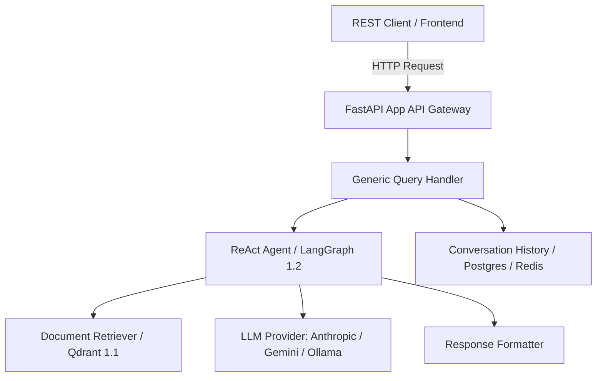

# Technical Design: Dependency Modernization to LangChain 1.4.9

## Architecture & Component Interaction
The core RAG engine interacts with language models, vector stores, and conversation stores via LangChain 1.4.x runnables:

## Interface Contracts & Schemas
The REST endpoints (`/api/v1/chat`, `/api/v1/history`) maintain their existing request/response JSON contracts while the internal dependency layer upgrades to LangChain Core 1.7.6 runnables.

## External API Integration & Resilience
- **LangChain Core 1.7.6**: Uses modern standard `Runnable` interfaces (`invoke`, `ainvoke`, `stream`, `astream`).
- **Resilience**: Backoff retry with exponential jitter for remote LLM calls (`langchain-anthropic`, `langchain-google-genai`).
- **Model Loader Fallbacks**: Offline fallback support for local reranking models (`FlagEmbedding`, sentence-transformers).

## Security & Operational NFRs
- All secrets and API keys loaded securely via environment variables (`python-dotenv`).
- Pydantic v2 data validation for request payloads.
- Fast startup (< 5s cold start) for FastAPI uvicorn workers.

